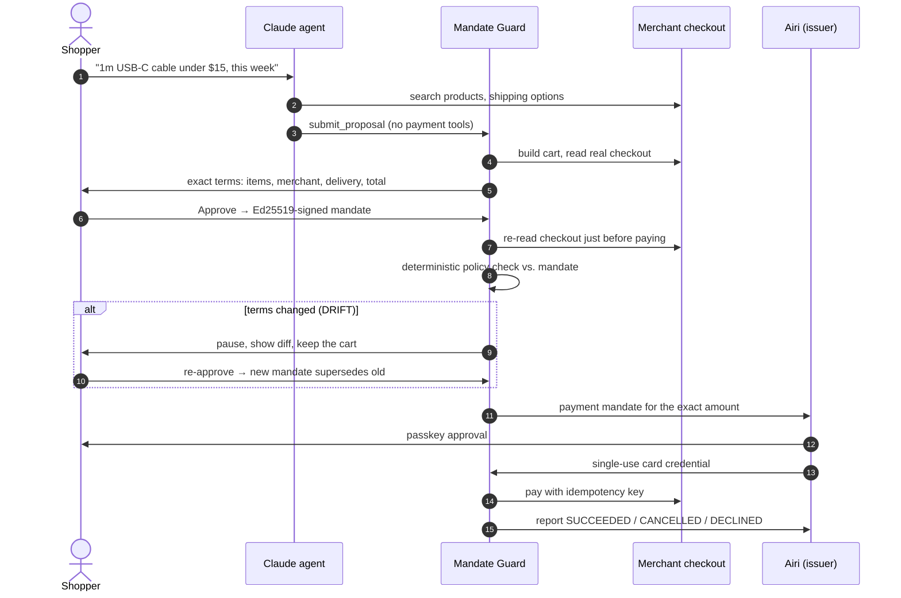
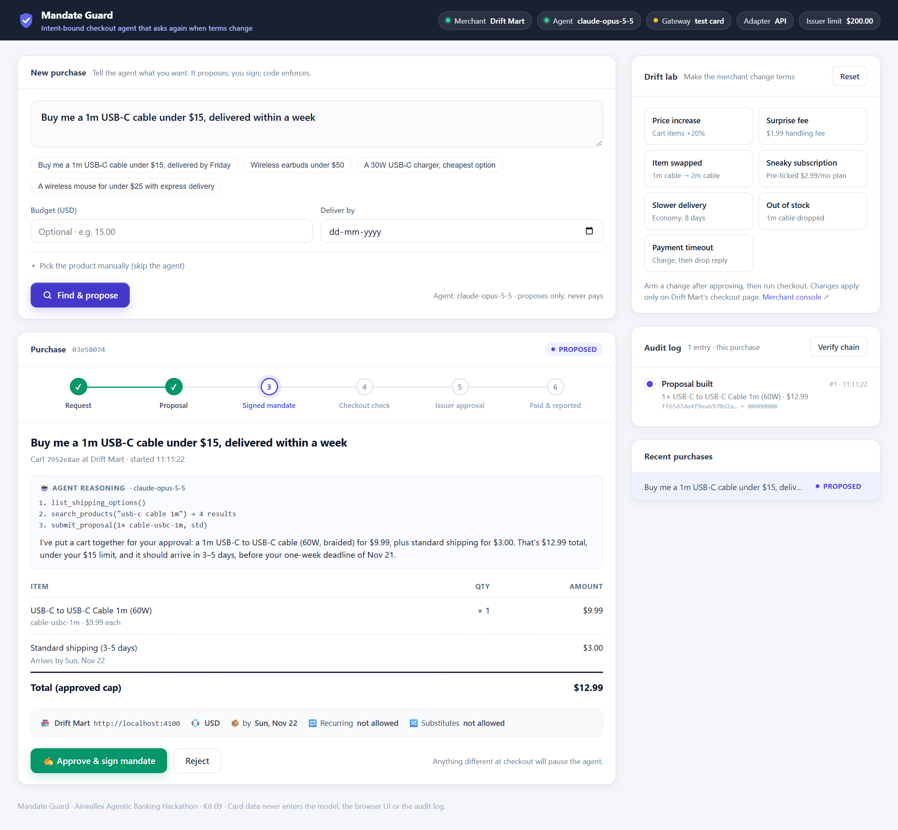
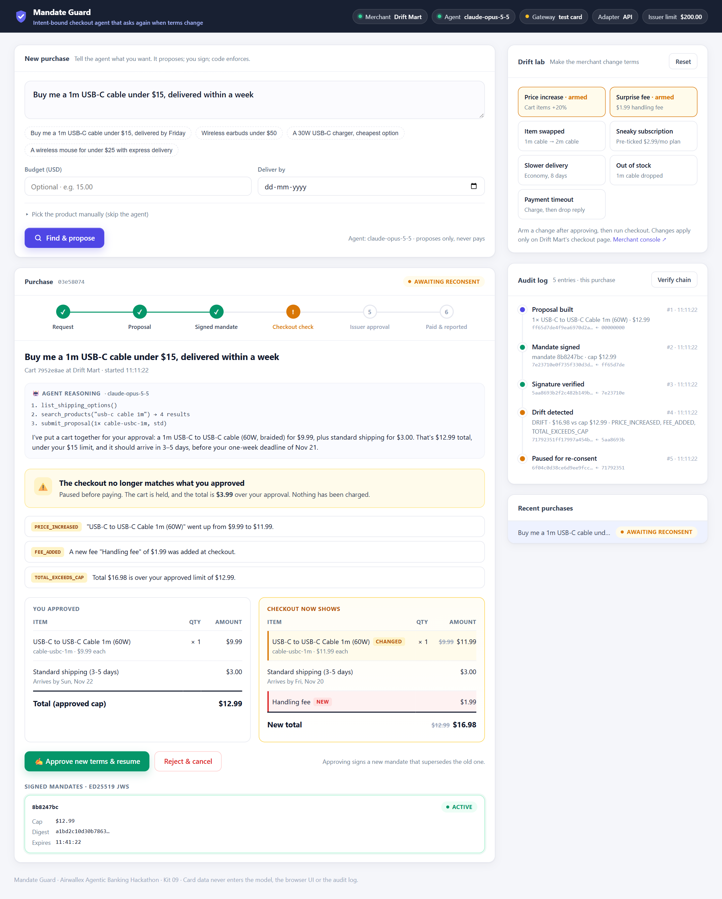
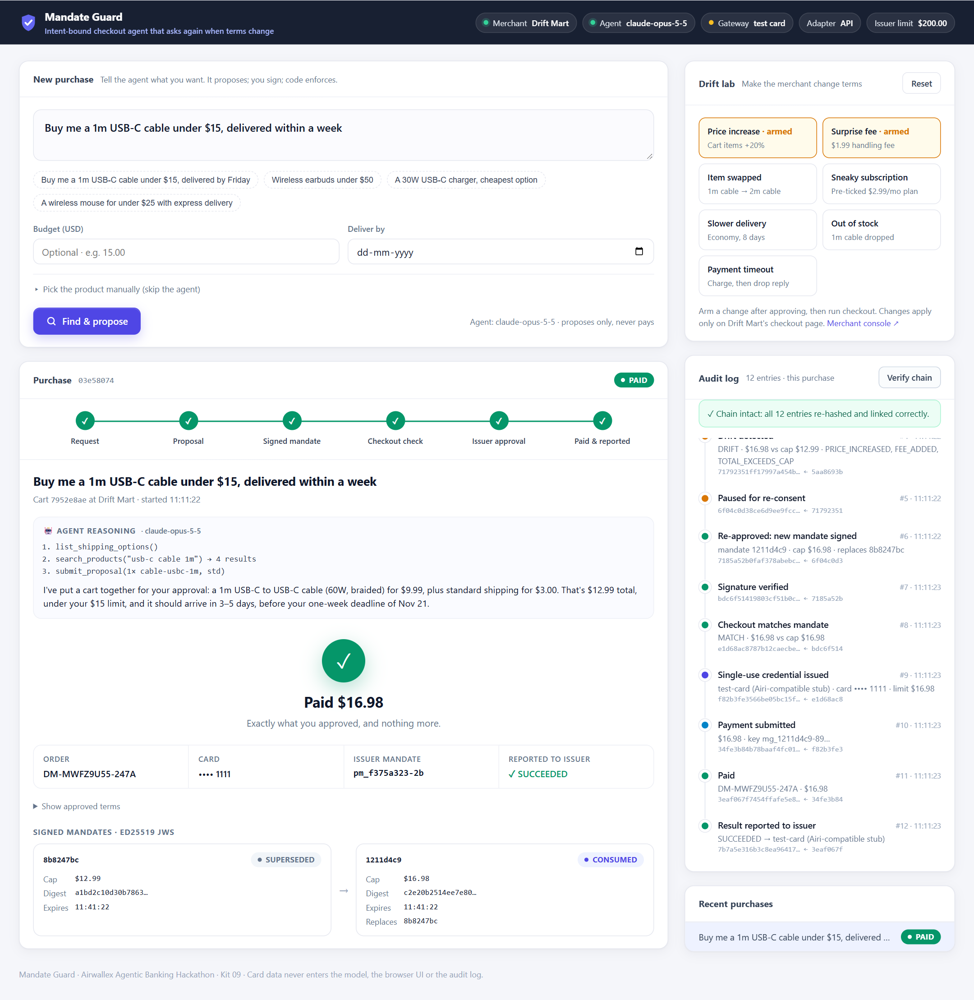

<div align="center">


# Mandate Guard

**An intent-bound checkout agent that asks again when terms change.**

Your "yes" becomes a signed mandate. The agent can only pay inside it.

[](https://github.com/Naazimsnh02/mandate-guard/actions/workflows/ci.yml)
[](LICENSE)


<br>


<br>
[](https://youtu.be/bWZdqyKE_LU)

*Airwallex Agentic Banking Hackathon · Starter Kit 09 · Agentic Commerce: Approval-Bound Shopping Agent*

<a href="https://youtu.be/bWZdqyKE_LU"></a>

**[▶ Watch the 4-minute demo](https://youtu.be/bWZdqyKE_LU)**: four drift scenarios plus a live payment on the real Airi CLI.

</div>

---

## Contents

- [Demo video](#demo-video)
- [The problem](#the-problem)
- [How it works](#how-it-works)
- [Verified end to end](#verified-end-to-end)
- [Screenshots](#screenshots)
- [Safety by design](#safety-by-design)
- [Architecture](#architecture)
- [Getting started](#getting-started)
- [Demo walkthrough](#demo-walkthrough)
- [Testing](#testing)
- [Project structure](#project-structure)
- [Limitations and roadmap](#limitations-and-roadmap)
- [License](#license)

## Demo video

[-FF0000?logo=youtube&logoColor=white)](https://youtu.be/bWZdqyKE_LU)

| Time | Chapter |
|---|---|
| 0:00 | The problem and the solution |
| 0:35 | Demo 1: happy path, signed mandate, exact match, paid |
| 1:19 | Demo 2: price rises and a fee appears after approval, pause and re-consent |
| 2:08 | Demo 3: a pre-ticked subscription is caught and cancelled |
| 2:33 | Demo 4: lost payment response, reconciled by idempotency key, one order |
| 3:07 | Verifying the hash-chained audit log |
| 3:14 | Live run on the real Airi CLI: passkey, single-use Visa credential, Airwallex charge |
| 3:44 | Safety by design |

## The problem

AI shopping agents can now complete real checkouts, but neither the shopper nor the bank can easily check that the agent bought **only what was approved**. Prices change between approval and payment. Shipping fees, pre-ticked subscriptions and substitute items appear at the last step. A one-time "yes" quietly becomes a blank cheque.

Card issuers can cap the **amount** of an agent payment, but they can't see what is in the cart. The merchant can't tell the card came from an agent at all. Someone has to bind the payment to *what the shopper actually agreed to*.

## How it works



1. **Capture intent.** Describe what you want in plain language, with an optional budget and deadline.
2. **Propose.** The Claude agent searches the catalog and proposes a cart. It has **no payment tools**: it can only propose. Code validates the SKU, stock, budget and delivery date before anything is shown.
3. **Sign the exact terms.** Your approval becomes a **signed mandate** (JWS, Ed25519) that binds merchant, items, quantities, unit prices, delivery option and latest delivery date, fees, currency, total cap and expiry.
4. **Verify at checkout.** Just before paying, a **deterministic policy engine** (code, not the LLM) re-reads the live checkout and diffs it line by line against the mandate.
5. **Re-consent on drift.** If anything changed, the agent **pauses, keeps the cart**, shows a before/after diff and asks again. Approving signs a **new mandate that supersedes the old one** and resumes the **same** checkout.
6. **Pay within limits.** Only on an exact match does it ask **Airi CLI** for a payment mandate for that exact amount. You approve with a passkey; Airi issues a single-use card credential. The merchant charges it through **Airwallex Payment Acceptance**, and the result is **reported back to Airi**.

### What the policy engine checks

| Outcome | Finding codes |
|---|---|
| **Re-consent** (pause and ask) | `PRICE_INCREASED` `QUANTITY_CHANGED` `ITEM_SUBSTITUTED` `ITEM_REMOVED` `FEE_ADDED` `FEE_INCREASED` `FULFILLMENT_CHANGED` `FULFILLMENT_COST_INCREASED` `DELIVERY_LATER` `RECURRING_ADDED` `TOTAL_EXCEEDS_CAP` |
| **Block** (never pay) | `MERCHANT_CHANGED` `CURRENCY_CHANGED` `MANDATE_EXPIRED` `ISSUER_LIMIT_EXCEEDED` `TOTAL_INCONSISTENT` |
| **Info** (pay, note it) | `PRICE_DECREASED` |

## Verified end to end

Everything below was run live against the real services, not mocks.

| Scenario | Path | Result |
|---|---|---|
| **Happy path, real processing** | Mandate MATCH → Airi passkey → single-use Visa credential → **Airwallex sandbox PaymentIntent `SUCCEEDED`** → order → `SUCCEEDED` reported to Airi | ✅ |
| **Drift during approval** | Merchant raised the price while the Airi passkey was pending → the merchant refused the stale total → Airi mandate reported `CANCELLED` → shopper re-approved → new mandate → paid on the **same cart** | ✅ |
| **Payment timeout** | Charge succeeded but the response was dropped → `UNCONFIRMED` → looked up the prior attempt by idempotency key → `PAID`, **exactly one order** | ✅ |
| **Audit integrity** | Hash chain recomputed end to end; no card numbers in the log; credential files deleted after use | ✅ |

> **Visa:** the credential is issued by Airi on a Visa card. The merchant sees a normal card transaction, so binding the cart to the shopper's intent has to happen on the agent side. That is exactly the gap Mandate Guard fills.

## Screenshots

| Agent proposal | Drift detected | Paid within mandate |
|---|---|---|
|  |  |  |

## Safety by design

| Layer | What it enforces |
|---|---|
| **Signed mandate** | Approval is bound to merchant, items, amount, currency, fulfillment and expiry. Any tampering breaks the Ed25519 signature |
| **Policy engine (code)** | Line-by-line checkout vs. mandate diff. The LLM cannot override it |
| **LLM boundary** | The agent only proposes: no payment tools, never sees card data. Merchant text is treated as untrusted input |
| **Issuer limit (Airi)** | Payment mandate for the exact total plus a passkey approval. Airi restricts the **amount**; Mandate Guard binds everything else |
| **Idempotent payment** | One idempotency key per mandate. A timeout is treated as *unconfirmed*, and every prior attempt is looked up before any retry. No double charges |
| **Credential hygiene** | The single-use credential is read once from a 0600 file and deleted, kept in memory only. Superseded or rejected mandates are reported `CANCELLED` to Airi |
| **Expiring mandates** | Stale approvals can't be reused |
| **Audit trail** | Every proposal, signature, policy decision, credential issue, payment and report is appended to a hash-chained JSONL log with a card-number guard. **Verify chain** recomputes every hash |

## Architecture

```
 ┌──────────── Web UI (vanilla HTML, :3000) ─────────────┐
 │ intent · mandate approval · drift diff · Airi passkey │
 │ drift lab · audit timeline · verify chain             │
 └──────────────────────────┬────────────────────────────┘
                            │ REST
 ┌──────────────────────────▼────────────────────────────┐
 │ App server (Node 22 + TypeScript, Fastify)            │
 │                                                       │
 │  Claude shopper agent (claude-opus-5-5, tool runner)  │
 │    tools: search_products, list_shipping_options,     │
 │           submit_proposal          (no payment tools) │
 │                                                       │
 │  Orchestrator state machine                           │
 │    PROPOSED → APPROVED → [policy check]               │
 │      MATCH → PAYING → PAID / DECLINED / UNCONFIRMED   │
 │      DRIFT → AWAITING_RECONSENT → re-sign, same cart  │
 │      BLOCK → BLOCKED                                  │
 │                                                       │
 │  Mandate service   Ed25519 JWS · expiry · supersedes  │
 │  Policy engine     deterministic diff                 │
 │  Merchant adapter  Playwright (Chrome) | HTTP         │
 │  Payment gateway   Airi CLI | test-card stub          │
 │  Audit log         hash-chained JSONL                 │
 └──────────────┬──────────────────────────┬─────────────┘
                │ browser / HTTP           │ airi-cli (execFile, no shell)
 ┌──────────────▼──────────────┐  ┌────────▼─────────────────────────┐
 │ Drift Mart merchant (:4000) │  │ Airi: payment mandate · passkey  │
 │ checkout · drift console    │  │ single-use credential · result   │
 │ idempotent pay              │  └──────────────────────────────────┘
 │ Airwallex Payment Acceptance│
 └─────────────────────────────┘
```

**Drift Mart** is a purpose-built demo merchant with a real storefront and checkout. It charges cards through Airwallex sandbox Payment Acceptance. Its **drift console** (`/admin`, or the *Drift lab* panel in the UI) can raise prices, add surprise fees, swap items, pre-tick a subscription, slow down delivery, drop stock or swallow a payment response on cue, so every scenario is repeatable on stage.

### Tech stack

| Area | Choice |
|---|---|
| Agent | Claude Opus 5.5 via `@anthropic-ai/sdk` tool runner (`betaZodTool`), adaptive thinking |
| Issuer | Airi CLI: payment mandate, passkey approval, single-use credential, result report |
| Payments | Airwallex Payment Acceptance (sandbox), PaymentIntent create + confirm |
| Mandates | `jose` (JWS, EdDSA/Ed25519) + `zod` schemas, integer minor units throughout |
| Browser automation | Playwright driving installed Google Chrome |
| Backend | Node 22, TypeScript (ESM, strict), Fastify 5 |
| UI | One self-contained HTML page, no build step |
| Tests | Vitest + a Playwright end-to-end smoke test, GitHub Actions CI |

## Getting started

### Quick start (no accounts needed)

Requires **Node 22+**.

```bash
git clone https://github.com/Naazimsnh02/mandate-guard.git
cd mandate-guard
npm install
cp .env.example .env
npm run dev          # Drift Mart on :4000, Mandate Guard on :3000
```

Open **http://localhost:3000**. With no keys set, the app uses an Airi-compatible test-card gateway and a simulated card processor, and you pick products manually. Every policy, drift and retry scenario works.

### Full setup

| To enable | Do this |
|---|---|
| **Claude agent** | Set `ANTHROPIC_API_KEY` |
| **Airwallex Payment Acceptance** | Create a sandbox account in a [supported region](https://www.airwallex.com/docs/payments/payment-methods), generate keys under *Account → Developer → API keys*, set `AIRWALLEX_CLIENT_ID`, `AIRWALLEX_API_KEY` and `DRIFT_MART_PROCESSOR=airwallex`. Drift Mart passes card details in the confirm call, so the sandbox needs raw card (native API) access enabled |
| **Real Airi CLI** | Set `GATEWAY=airi` (see below) |
| **Real browser checkout** | Set `MERCHANT_ADAPTER=browser` (Google Chrome required), plus `HEADED=1` to watch the agent drive it |

#### Airi CLI

Airi CLI access is allowlisted during the beta. `airi-cli` ships macOS/Linux binaries; on Windows, use the bundled container:

```bash
docker build -t mandate-guard-airi docker/airi
docker run -d --name mandate-guard-airi -v airi-home:/root mandate-guard-airi
docker exec mandate-guard-airi airi-cli auth login -o json    # open the URL and approve
docker exec mandate-guard-airi airi-cli auth poll
docker exec mandate-guard-airi airi-cli payment-methods list  # your card should be listed
```

Then set `GATEWAY=airi` and `AIRI_EXEC_PREFIX=docker exec -i mandate-guard-airi` (leave it empty if `airi-cli` is installed natively). At payment time the UI shows Airi's passkey approval link.

### Configuration

| Variable | Purpose | Default |
|---|---|---|
| `ANTHROPIC_API_KEY` | Enables the Claude shopper agent | *(agent off)* |
| `MANDATE_GUARD_MODEL` | Override the agent model | `claude-opus-5-5` |
| `GATEWAY` | `test` (Airi-compatible stub) or `airi` (real Airi CLI) | `test` |
| `AIRI_EXEC_PREFIX` | How to reach `airi-cli`, e.g. `docker exec -i mandate-guard-airi` | *(native)* |
| `AIRI_PAYMENT_METHOD_ID` | Airi payment method to use | default card |
| `AIRI_MERCHANT_COUNTRY` | Merchant country sent to Airi | `US` |
| `AIRI_CREDENTIAL_TIMEOUT` | Seconds to wait for the passkey approval | `300` |
| `DRIFT_MART_PROCESSOR` | `simulated` or `airwallex` | `simulated` |
| `AIRWALLEX_CLIENT_ID` / `AIRWALLEX_API_KEY` | Airwallex sandbox credentials | — |
| `AIRWALLEX_BASE_URL` | Airwallex API base URL | sandbox |
| `MERCHANT_ADAPTER` | `http` (structured API) or `browser` (Playwright on the real pages) | `http` |
| `HEADED` | `1` shows the Chrome window the agent drives | off |
| `APP_PORT` / `DRIFT_MART_PORT` | Ports | `3000` / `4000` |
| `MANDATE_SIGNING_KEY_PATH` | Ed25519 key (generated on first run, git-ignored) | `./data/keys/mandate-ed25519.jwk` |
| `AUDIT_LOG_PATH` | Hash-chained audit log | `./data/audit/audit.jsonl` |

## Demo walkthrough

1. **Ask.** "Buy me a 1m USB-C cable under $15, delivered by Friday" → **Find & propose**. The agent's tool calls and reasoning are shown next to the exact terms.
2. **Sign.** **Approve & sign mandate**: a signed mandate appears in the mandate chain.
3. **Happy path.** **Run checkout** → the checkout matches → (with Airi) open the passkey link and approve → **Paid**, reported to Airi.
4. **Drift.** On a new purchase, after signing, arm *Price increase* and *Surprise fee* in the **Drift lab**, then **Run checkout**. The agent pauses and shows exactly what changed. **Approve new terms & resume** signs a superseding mandate and pays on the same cart.
5. **Retry safety.** Arm *Payment timeout* → **Run checkout** → the payment is *unconfirmed* → **Look up attempt** finds the charge. One order, no double charge.
6. **Audit.** Expand any timeline entry, then press **Verify chain** to recompute every hash.

## Testing

```bash
npm test               # 45 unit + integration tests (policy, mandate, merchant, orchestrator, Airi gateway, audit)
npm run typecheck      # strict TypeScript
npm run smoke:browser  # Playwright end to end: drift → re-consent → paid; timeout → reconcile → one order
```

The orchestrator tests run a real Drift Mart instance on a free port. The Airi gateway tests use a fake CLI, so no accounts are needed. CI runs typecheck and tests on every push.

## Project structure

```
src/
  agent/shopper.ts            Claude agent: search, shipping, submit_proposal (code-validated)
  app/server.ts               Fastify API + static UI
  app/ui.html                 Single-page UI
  orchestrator/session.ts     State machine: propose → approve → check → pay → reconcile → report
  mandate/                    Mandate schema, Ed25519 JWS signing/verification, amendments
  policy/                     Checkout snapshot + deterministic policy engine
  payments/gateway.ts         Airi CLI gateway and Airi-compatible test-card gateway
  merchant/                   Merchant adapter interface
  merchant/drift-mart/        Demo merchant: store, server, drift console, HTTP + browser adapters, processors
  audit/log.ts                Hash-chained, append-only audit log
  lib/                        Airwallex client, canonical JSON, money helpers
  dev.ts                      Starts the merchant and the app
tests/                        Vitest suites
scripts/smoke-browser.ts      Playwright end-to-end smoke test
docker/airi/                  Container for airi-cli on Windows
```

## Limitations and roadmap

- **Sessions are in memory.** The audit log persists, but session state does not survive a restart.
- **Single demo merchant.** Next is a read-only adapter for a live Shopify store, to detect drift on real-world checkouts.
- **Authorise then capture.** Authorise at approval time and capture only after the final match, so price drift between authorisation and capture is impossible.
- **Merchant-visible agent signals.** Pass the signed mandate digest to merchants and networks (for example via Visa's agentic protocols) so they can verify what the shopper approved.

## License

[MIT](LICENSE) © 2026 Syed Naazim Hussain. Built for the Airwallex Agentic Banking Hackathon.
